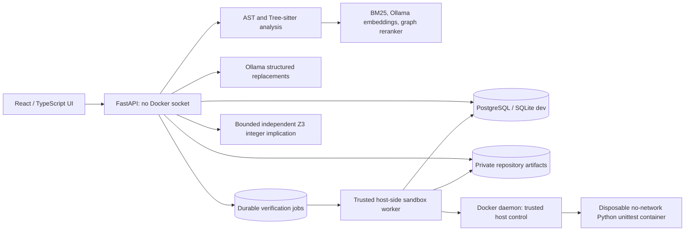
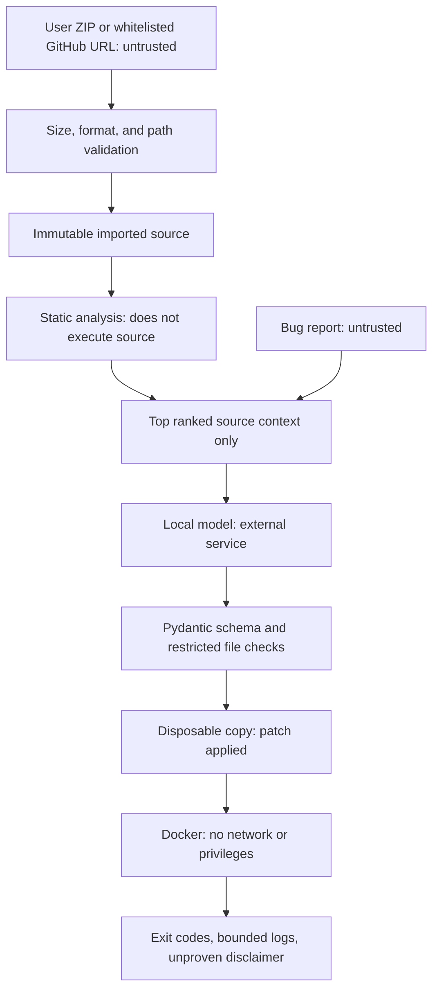

# Architecture and contracts

## Execution topology (single-tenant)

See `docs/TRUSTED_WORKER.md` for required installation and trust boundaries.
The API **queues** verification and returns HTTP 202. Only the trusted worker
constructs disposable workspaces or executes Docker. No source/tests run on
application host directly. The single-tenant model is not suitable for hostile
multi-tenant use.

## Data flow and trust boundaries

API and Git clone control are trusted infrastructure. Uploaded repository code is never imported as a module in the API process. The model context contains source snippets and potentially malicious issue text; instructions in those inputs are not authoritative. Model output is strictly a suggestion.

## Persistent entities

- Repository: UUID, digest, name, status, indexed symbol metadata.
- Issue: UUID, repository ID, description, expected and observed behavior.
- RepairRun: UUID, issue ID, localization method, ranked locations, execution state.
- Candidate: UUID, exact old/new code, unified diff, optional generated regression test, model provenance and token-count metadata when Ollama provides it, explicit approval timestamp and validation evidence.
- VerificationJob: UUID, run and candidate ownership, durable queued/running/terminal state, worker lease, cancellation and bounded evidence.
- AuditEvent: action, target UUID, detail, timestamp.

Transactions are managed with SQLAlchemy sessions. A bounded two-worker in-memory generator supports four queued/running jobs. Queued and running records become `interrupted` after restart; they must be retried manually. This is not a durable distributed job system.

## Ranking

For each indexed file `i`, compute BM25 with `k1=1.2`, `b=0.75`. Normalize the BM25 scores by their per-query positive maximum to produce `L_i`. For configured local-model embeddings, compute cosine similarity between issue and bounded file context, clamp negative values to zero, and normalize to obtain `S_i`. For the undirected one-hop import-neighbor set `N(i)`, take:

`G_i = Normalize(max_{j in N(i)} (0.65 L_j + 0.35 S_j))`

The hybrid score is `0.55 L_i + 0.30 S_i + 0.15 G_i` (or the graph term is zero in a no-graph ablation). Lexical and semantic baselines use `L_i` and `S_i` respectively. All results are ordered by descending score and then path for tie determinism. This is a heuristic, not a learned calibrated probability.

## Operational limitations

- 3,000 indexed files maximum, 750 KB per file, bounded ZIP and Git ingestion.
- Semantic inference requires Ollama with an installed embedding model. No misleading token-vector fallback.
- Candidate edit format is a unique exact-string replacement in a ranked file, not arbitrary multi-file rewrites.
- Only Python `unittest` test discovery is supported by the Docker runner; JavaScript test execution is not implemented.
- React frontend and PostgreSQL path need clean-environment integration tests.
- Docker executor in the host API deployment uses the host's Docker CLI and daemon, which makes the trusted control plane security critical.

## Evidence-based candidate priority

Candidates are sorted for review by `10 + T + R − min(10, 0.2 E)` where `E` is count of changed unified-diff lines, `T = +50` for passing existing tests, `−40` for failed tests and `0` for unavailable or unrun, and `R = +30` only if a separately discovered targeted regression fails before and passes after the patch. The score is **not calibrated confidence**; unverified candidates still require human review. Approval authorizes *export only*; it never applies a patch to the original repository.

## Admission-control correctness, release-candidate update

Verification submission obtains a short transaction-scoped PostgreSQL advisory
lock before locking the candidate row and checking the shared `MAX_QUEUED`
count. This guards the **global** queue cap across concurrent PostgreSQL API
instances; candidate row locking alone prevents duplicates only for one
candidate. SQLite remains development-only for multi-process admission.

The neural retrieval client rejects embedding batch cardinality/dimension
mismatches; it does not silently truncate ranking results. Code indexing
independently bounds scanned files, visited directories, and indexed source
bytes. These measures bound selected work but do not imply arbitrary hostile
repository ingestion is safe at Internet scale.

`benchmarks/repair_trials.py` records the original test status and calls only
the Docker-only verifier. No untrusted repository code is executed by the
benchmark controller on the host. The real-model, actual-container evaluation
remains an **unverified** deployment gate until external infrastructure runs.
