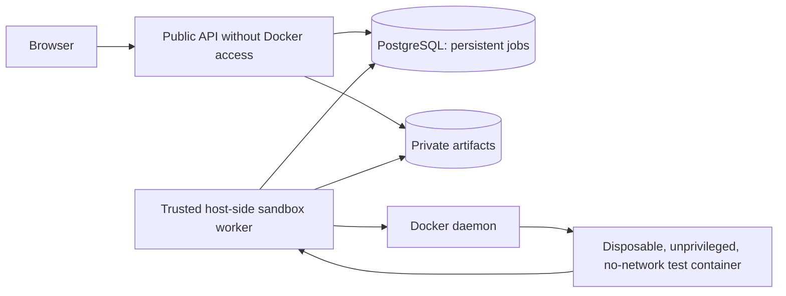

# Trusted verification worker: single-tenant deployment

**Security model:** API, model service, and browser are untrusted as repair authorities. Imported repositories, bug reports, and model answers are always untrusted. The **host-side worker is trusted software** installed by the operator and given **database access, repository read access, and Docker CLI access**. This deployment is **not** safe for arbitrary hostile multi-tenant submissions. Docker does not prevent kernel exploits or all side channels.



## Mandatory separation

1. The API **never calls Docker or hosts subprocesses for repository tests**. `POST /api/repairs/{run_id}/verify?candidate_id=...` commits a durable `queued` job and returns HTTP 202. `GET /api/jobs/{job_id}` is read-only. `POST /api/jobs/{job_id}/cancel` stores cancellation.
2. The trusted worker is a **separate operating-system process**: `python -m packages.sandbox_worker --poll-seconds 1`. Run **one worker process** per tenant. It atomically claims a job and performs patching only in a disposable directory. Worker refuses mismatching job/run/candidate relationships and exact original content mismatches. The worker owns Docker client access, which grants effective host-level privileges; do not co-locate it with a public web-facing API process.
3. The Docker container uses `python:3.12-alpine` or `node:22-alpine` (operators should pin both digests before production deployment), a readonly source bind, `--network none`, no additional capabilities, no new privileges, UID 65534, read-only root filesystem, writable restricted `/tmp`, CPU/256 MiB memory/64 processes/timeout budgets, bounded output capture, and cleanup on timeout and cancellation.
4. PostgreSQL stores verification status and results. Expired `running` jobs become **interrupted**, never automatically retried. Operators must explicitly resubmit after confirming the prior Docker container is gone. A worker cannot overwrite a cancelled or interrupted job.
5. The API is currently **single-tenant** with one API key, not a multiuser RBAC system. Keep ports on loopback, restrict public ingress via a trusted reverse proxy, and use different restricted database credentials for API and worker if deploying beyond local development.

## Local orchestration

With Python 3.12, Docker Desktop, and PostgreSQL configured:

```bash
# Terminal 1: infrastructure and DB migration
# Create .runtime/data so the host worker and API share the exact folder
mkdir -p .runtime/data
docker compose up -d db
python -m alembic upgrade head

# Terminal 2: trusted worker (host; not a public API container)
# PATCHPROOF_DATABASE_URL must target 127.0.0.1:5432
# PATCHPROOF_DATA must equal absolute path of .runtime/data
python -m packages.sandbox_worker --poll-seconds 1

# Terminal 3: API (host for development, or docker compose up -d api)
python -m uvicorn apps.api.main:app --host 127.0.0.1 --port 8000
```

Linux bind-mount prerequisites for Compose API: ensure `.runtime/data` is writable by the non-root UID configured via `PATCHPROOF_HOST_UID`/`PATCHPROOF_HOST_GID` (defaults 10001). Prefer `PATCHPROOF_HOST_UID=$(id -u)` and `PATCHPROOF_HOST_GID=$(id -g)` if your user owns the directory; do not make files world writable. On Windows Docker Desktop, test bind-mount permissions and host access before relying on Compose mode. If the API and worker don't share *exactly the same repository files*, verification will fail closed.

No Docker socket is mounted into the API, and the worker is *not* reachable through any HTTP endpoint. Don't run a remote Docker daemon with unauthenticated TCP access. Run `scripts/test_sandbox.ps1` (Windows) or `scripts/test_sandbox.sh` (Linux/macOS) for real sandbox tests. These tests must pass before treating Docker execution as verified.

## Constraints and non-guarantees

- The Docker runner supports Python `unittest` discovery and dependency-free Node.js built-in `.js` tests located under `tests/`. `.tsx`, `.ts` and JSX execution remain unsupported, and no passing Python suite may be used as evidence for a non-Python patch.
- The test runner uses a shared host Docker daemon. Escalation through the daemon or a kernel vulnerability may compromise the host. In hostile/public scenarios use VM or microVM isolation and separate untrusted execution hosts.
- Malicious repository content may still appear in model context; redaction is best-effort and is not a secret-proofing guarantee.
- A cancelled worker polls cancellation; in-flight Docker start/cleanup may take a small bounded delay. The DB remains authoritative.
- Queue capacity is bounded by application-level checks; concurrent multi-instance admission control is not guaranteed on SQLite. PostgreSQL is required for deployment, and multi-instance API concurrency needs additional admission coordination.

### Deployment source updates (unverified until Docker runs)

Compose now runs a trusted `prepare-data` initialization container to make the bind-mounted artifact directory accessible to the **non-root** API UID/GID (set `PATCHPROOF_HOST_UID` and `PATCHPROOF_HOST_GID` to the trusted host worker's numeric UID/GID on Linux). It also performs `alembic upgrade head` in a one-shot `migrate` service before admitting API traffic. The worker performs a PatchProof-label-restricted Docker orphan cleanup on startup. **Exactly one host worker per tenant is supported.**

Read-only bind mounts and `--network none` are retained for untrusted test containers. Local Docker Compose deployment, host/worker shared-folder read permissions, migration transaction behavior and cleanup all require real environment verification.


## Allowlisted Python pytest verification (source-level addition)

Python projects with `pytest.ini`, `[tool.pytest]` or a `pytest`-importing test
file under `tests/` are automatically routed to a **separately built trusted
pytest image**, `patchproof-pytest:3.12-9.0.2`. The operator builds that image
**before** accepting untrusted verification jobs:

```bash
docker build -f docker/pytest-runner.Dockerfile -t patchproof-pytest:3.12-9.0.2 .
```

The trusted build downloads pinned `pytest==9.0.2`; untrusted repositories run
with `--network none` and **cannot** download dependencies. Only Python `unittest`
and `pytest`, plus the already supported Node.js built-in test runner for plain
`.js` files, are approved. Unsupported frameworks, missing dependencies,
zero discovered tests, and collection errors are **not** successful verification.
The service does not claim to run arbitrary project-specific dependency stacks
or test services. JavaScript JSX and TypeScript test execution remain unsupported.

The `docker/pytest-runner.Dockerfile` is intentionally separate from the public
API image, which has no daemon or Docker socket access. On Docker-enabled CI, the
integration suite uses the real daemon and verifies success, failures, zero-test
handling, and pytest collection errors. The source-level unit tests exercise
runner selection and result classification without claiming actual isolation.
